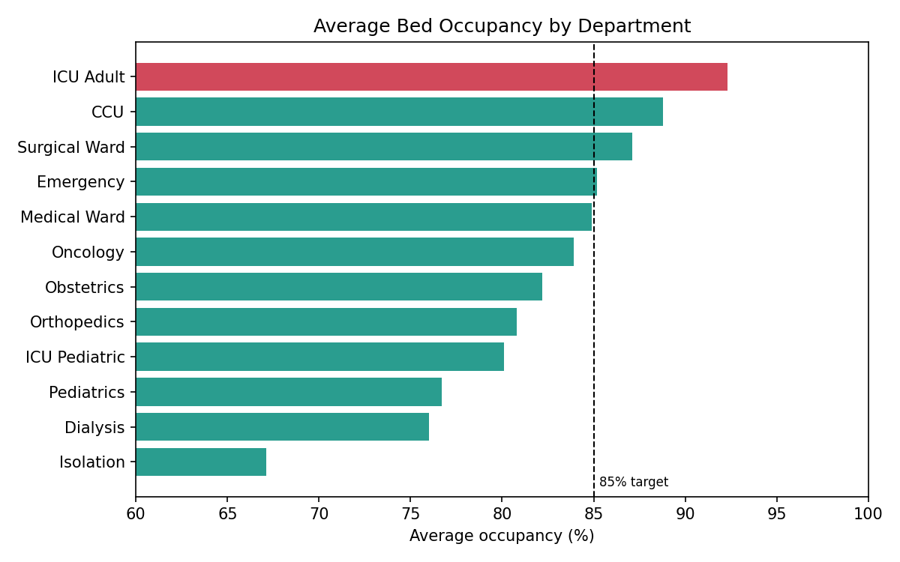
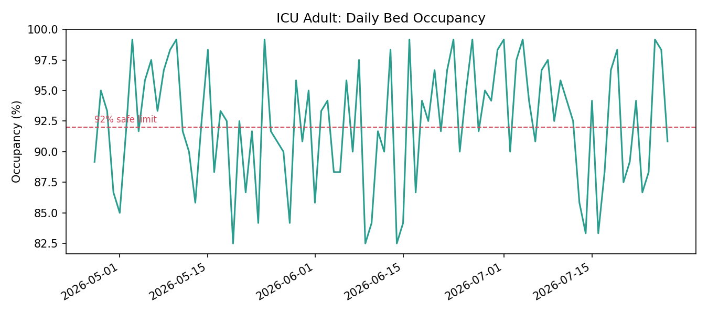
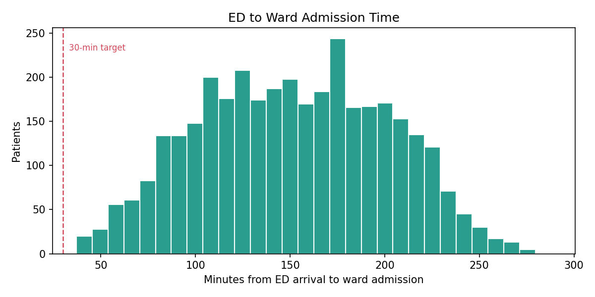
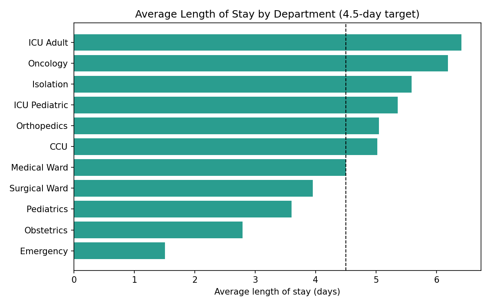

# 1,000-Bed Hospital: Bed Capacity & Operational Performance Analysis

> **Note on data:** This project uses a **synthetic dataset** for a **fictional** 1,000-bed hospital (12 departments, 92 days: 27 Apr to 27 Jul 2026). It was created for portfolio purposes. No real patient or hospital data is used.

## Objective
Review bed capacity and operational performance against the hospital's KPI targets, and identify where the pressure points are.

## Key Findings

| KPI | Result | Target | Status |
|---|---|---|---|
| Hospital-wide bed occupancy | 84.7% | 85% | Met |
| ICU Adult occupancy | 92.3% | < 92% | Not met |
| Average length of stay | 4.28 days | 4.5 days | Met |
| ED arrival to ward admission (median) | 152 min | < 30 min | Not met |

1. **The hospital-wide average hides the real pressure.** Overall occupancy sits right on target, but **ICU Adult** averages 92.3%, is above its 92% safe limit on **53% of days**, and is above 90% on 66% of days. CCU is also high at 88.8%.
2. **ED to ward admission is the largest gap.** The median is 152 minutes, and none of the 3,500 tracked patients reached a ward within the 30-minute target.
3. **Length of stay is on target overall (4.28 days)**, but varies widely: ICU Adult (6.4 days) and Oncology (6.2 days) are the longest.
4. **Nurse workload is tight in critical care.** ICU and CCU run at about 2.0 patients per nurse, exactly at the 1:2 limit with no buffer. Obstetrics (5.07) and Dialysis (5.12) are slightly above the 1:5 ward target. *(Approximation: based on daily staff counts, not shift-level rosters.)*
5. **Forecast:** the 30-day forecast shows average occupancy of about 84.3%, stable, with a band of roughly ±4 points.






## Tools Used
- **Python**: Pandas, Matplotlib
- **Excel** workbook with 8 sheets (departments, daily bed counts, admissions, staffing, bed status, patient flow, forecast, KPI targets)

## Limitations
- Synthetic data: it demonstrates the analytical approach, not real hospital performance.
- **Patient_Admissions (10,200 records) looks like a sample**: its bed-days (about 43,700) are well below the occupied bed-days in the bed status data (about 78,000). For that reason, **bed turnover rate was not calculated**.
- **Readmission rate was not calculated**: the dataset has no repeat patient IDs.
- The forecast accuracy (MAPE) cannot be checked because the dataset has no actual values for the forecast period.

## Repository Structure
```
1000-Bed-Hospital-/
├── Hospital_1000Bed_Dataset.xlsx     # Synthetic dataset (8 sheets)
├── analyze_beds.py                   # Analysis + chart generation
├── department_scorecard.csv          # Occupancy, LOS, nurse workload by department
├── kpi_scorecard.csv                 # Hospital KPIs vs targets
├── chart_occupancy_by_department.png
├── chart_icu_adult_trend.png
├── chart_ed_wait_time.png
├── chart_length_of_stay.png
└── README.md
```

## How to Run
```
pip install pandas matplotlib openpyxl
python analyze_beds.py
```

## Project Status
Python analysis complete. Next: interactive Power BI executive dashboard.

## Author
**Yosra El Nagar**: Nursing Supervisor transitioning into Healthcare Data Analytics
[LinkedIn](https://www.linkedin.com/in/yosra-nagar-9a6862118/)

---

## 🇸🇦 ملخص بالعربي

دراسة حالة تحليلية لمستشفى **وهمي** (1000 سرير) باستخدام **بيانات تجريبية (Synthetic)**، لأغراض البورتفوليو فقط.

- **متوسط الإشغال في المستشفى ككل 84.7%**، قريب من الهدف (85%)، لكن ده بيخبّي الضغط الحقيقي.
- **العناية المركزة للبالغين (ICU Adult)** متوسط إشغالها 92.3%، وفوق الحد الآمن (92%) في **53% من الأيام**.
- **الانتقال من الطوارئ للعنبر:** الوسيط 152 دقيقة مقابل هدف أقل من 30 دقيقة، ولا مريض من 3,500 وصل للهدف.
- **متوسط مدة الإقامة 4.28 يوم** (الهدف 4.5)، لكن العناية المركزة والأورام أطول الأقسام.
- **القيود:** البيانات وهمية، ولم يتم حساب معدل دوران الأسرّة ولا إعادة الدخول لعدم كفاية البيانات.
